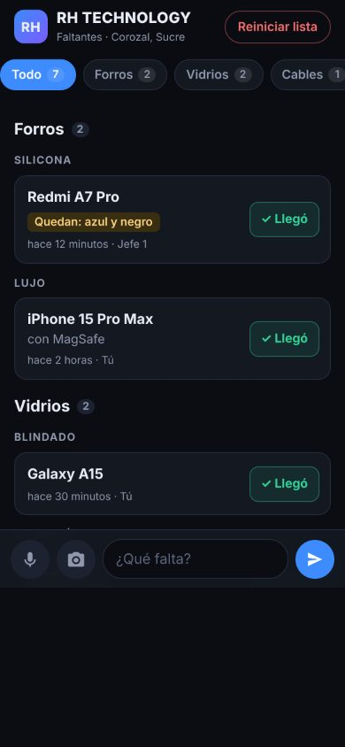
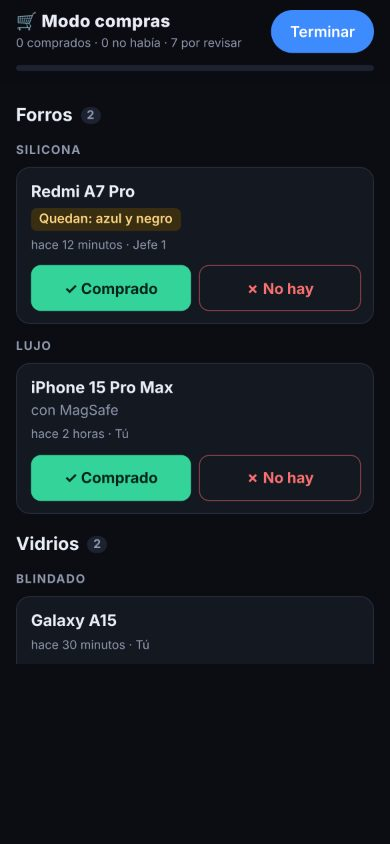
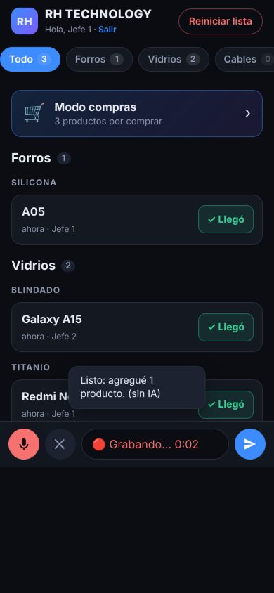
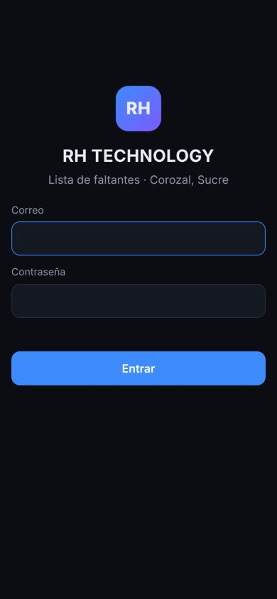

# RH TECHNOLOGY · Faltantes

App web instalable (PWA) para la tienda **RH TECHNOLOGY** de Corozal, Sucre (celulares y accesorios).
Cualquiera del equipo dice lo que falta **escribiendo, con un audio o con una foto**, y la app lo guarda
solo en la categoría correcta. Los jefes ven la misma lista **en tiempo real** desde sus iPhone y, cuando
salen a comprar, usan el **Modo compras** para marcar lo que encontraron y lo que no.

| Lista de faltantes | Modo compras | Audio | Login |
|---|---|---|---|
|  |  |  |  |

---

## ✨ Funciones

- **Entrada natural:** "No hay forro de silicona Redmi A7 Pro, quedan azul y negro" se guarda en
  *Forros › Silicona* con la etiqueta *Quedan: azul y negro*.
- **Celulares:** "Falta el Redmi 13C de 128 gigas y 6 de RAM" se guarda en *Celulares › Xiaomi* con el
  detalle *128 GB · 6 GB RAM*. Entiende también "4+128" y "de 128".
- **Audio y foto:** se graba un audio o se toma una foto de la caja y la IA (Gemini) lo entiende.
- **"Ya llegó…"** quita el producto, y **"ya se actualizó / ya se surtió todo"** vacía la lista
  (con un modal de confirmación propio).
- **Tiempo real:** lo que agrega una persona aparece al instante en los demás celulares.
- **Modo compras:** lista organizada para comprar, con **✓ Comprado** y **✗ No hay**. Lo comprado queda
  como "🛒 Comprado" hasta que llega; lo que no se consiguió vuelve a la lista para la próxima vez.
- **Respaldo sin IA:** si la IA falla, un clasificador por palabras clave entiende el texto.
- **PWA:** se instala en iPhone y Android (la app muestra un botón "Instalar la app"), abre sin internet,
  recuerda la sesión y respeta el notch (safe-area).
- **Modo demo:** sin configuración (o con `?demo` en la URL) funciona con datos de prueba, ideal para
  mostrar el proyecto.

## 🧱 Tecnologías

| Parte | Tecnología |
|---|---|
| Frontend | HTML, CSS y JavaScript puro (módulos ES, sin frameworks ni build) |
| Base de datos y tiempo real | Supabase (PostgreSQL + Realtime) |
| Login | Supabase Auth (correo y contraseña, solo 3 cuentas) |
| Seguridad de datos | Row Level Security (RLS), CHECK y triggers en PostgreSQL |
| IA | Supabase Edge Function (Deno) + API de Gemini |
| Hosting | GitHub Pages con GitHub Actions |
| Pruebas | `node --test` (clasificador) |

## 🗂️ Estructura

```
├── index.html                  Única página: login + app + modo compras
├── manifest.json · sw.js       PWA (instalación y caché sin conexión)
├── css/styles.css              Mobile-first, modo oscuro, safe-area
├── js/
│   ├── app.js                  Arranque: conecta datos, IA e interfaz
│   ├── ui.js                   Dibuja pestañas, tarjetas, modo compras, modal y toasts
│   ├── categorias.js           Categorías y subtipos (una sola fuente)
│   ├── clasificador.js         Respaldo sin IA (función pura, con pruebas)
│   ├── datos.js                "Fachada": elige demo o Supabase
│   ├── datos-demo.js           Datos en localStorage
│   ├── datos-supabase.js       Datos en Supabase + Realtime
│   ├── supabase.js · auth.js   Cliente y login
│   ├── ia.js                   Llama a la Edge Function
│   ├── media.js                Grabar audio y preparar fotos
│   └── config.example.js       Plantilla (config.js real NO se sube)
├── icons/                      Iconos de la app
├── supabase/
│   ├── schema.sql              Tablas, RLS, triggers y Realtime
│   └── functions/procesar/     Edge Function con Gemini
├── pruebas/                    Pruebas del clasificador
└── .github/workflows/deploy.yml  Publicación automática
```

## 🔄 Cómo funciona

```
Celular ──(texto / audio / foto)──► Edge Function "procesar" ──► Gemini
   ▲                                   │ (lee la lista con RLS,       │
   │                                   │  valida la respuesta)        │
   │                                   ◄──────── JSON de acciones ────┘
   │  la app aplica: vaciar → quitar → agregar
   │
Supabase (tabla faltantes) ──Realtime──► todos los celulares
```

La IA solo **interpreta**; quien guarda es la app. Así el modal de "¿Vaciar la lista?" aparece antes
de borrar, y el clasificador de respaldo usa el mismo camino. Gemini responde con un formato JSON fijo:

```json
{"acciones":[{"tipo":"agregar","categoria":"forros","subtipo":"silicona","modelo":"Redmi A7 Pro","detalle":"","quedan":"azul y negro"},
             {"tipo":"quitar","id":"..."},{"tipo":"vaciar"}],
 "respuesta":"frase corta"}
```

## 🔒 Seguridad

- **Solo 3 cuentas:** registro público desactivado + tabla `usuarios_permitidos`. Aunque alguien
  tuviera una cuenta, si su correo no está en la lista no puede leer ni escribir.
- **RLS** en todas las tablas: sin sesión no hay acceso a nada (probado).
- **El servidor pone el autor:** `creado_por`, `estado_por` y las fechas los llena un trigger, nadie puede
  hacerse pasar por otro.
- **Permisos por columna:** la app solo puede modificar la columna `estado` (Modo compras).
- **CHECK en la base:** no se aceptan categorías inventadas ni textos gigantes.
- **API key de Gemini** solo como *secret* de la Edge Function; nunca llega al navegador.
- **La respuesta de la IA se valida:** ids que existan, categorías válidas, textos recortados.
- **Sin `innerHTML` con datos:** todo se pinta con `textContent`.
- **Sin claves en el repositorio:** `js/config.js` está en `.gitignore`; GitHub Actions lo crea al publicar.
  (La clave *publicable* de Supabase está hecha para ir en el navegador; quien protege los datos es RLS.)

---

## 🛠️ Configuración paso a paso

### 1. Supabase

1. Crea una cuenta en [supabase.com](https://supabase.com) → **New project** (región *East US* es la más
   cercana a Colombia).
2. **Desactiva el registro público:** Authentication → Sign In / Providers → apaga
   *Allow new users to sign up*.
3. **Crea las 3 cuentas:** Authentication → Users → **Add user → Create new user**, marcando
   *Auto Confirm User*.
4. **Ejecuta el esquema:** abre `supabase/schema.sql`, cambia en la sección 1 los correos (en minúsculas)
   y los nombres que se verán en las tarjetas. Luego en **SQL Editor → New query** pega todo y presiona
   **Run**. Si aparece "destructive operation", confirma: solo recrea reglas, no borra datos.
   Se puede ejecutar varias veces sin problema.
5. Verifica en **Table Editor** que `faltantes` y `usuarios_permitidos` digan **RLS enabled**.

### 2. Gemini (IA)

1. Crea una API key gratis en [aistudio.google.com/apikey](https://aistudio.google.com/apikey).
2. En Supabase → **Edge Functions → Secrets → Add new secret**:
   `GEMINI_API_KEY` = tu clave.
3. (Opcional) `GEMINI_MODEL` para probar otro modelo primero. Por defecto usa `gemini-3.5-flash-lite` y, si
   está saturado o sin cuota, `gemini-3.1-flash-lite`. En pruebas reales los modelos *Lite* respondieron en
   ~1 s (texto) y ~2 s (foto) con resultados correctos; los modelos Flash grandes tardaban 15-45 s o estaban
   saturados.

### 3. Desplegar la Edge Function

Con la [CLI de Supabase](https://supabase.com/docs/guides/cli) (no necesita Docker):

```bash
npx supabase login
npx supabase functions deploy procesar --project-ref TU_PROJECT_REF --no-verify-jwt --use-api
```

`--no-verify-jwt` es intencional: la función misma valida la sesión llamando a `mi_perfil` con el token del
usuario, y rechaza a cualquiera que no esté en la lista.

> También se puede crear desde el panel: Edge Functions → **Deploy a new function → Via Editor**, nombre
> `procesar`, pegar `supabase/functions/procesar/index.ts` y desactivar *Verify JWT*.

### 4. Probar en tu computador

```bash
cp js/config.example.js js/config.js   # y pega tu Project URL y tu clave publicable
python3 -m http.server 8080            # abre http://localhost:8080
```

La URL y la clave están en Supabase → **Project Settings → API Keys** (usa la *publishable*
`sb_publishable_...`, **nunca** la *secret*).

### 5. Publicar en GitHub Pages

1. En el repositorio: **Settings → Pages → Source: GitHub Actions**.
2. **Settings → Secrets and variables → Actions → New repository secret:**
   - `SUPABASE_URL` = `https://TU-PROYECTO.supabase.co`
   - `SUPABASE_PUBLISHABLE_KEY` = `sb_publishable_...`
3. Haz push a `main`. En la pestaña **Actions** verás el progreso; al terminar, la app queda en
   `https://TU-USUARIO.github.io/NOMBRE-DEL-REPO/`.

---

## 📱 Instalar la app

### iPhone (Safari)
1. Abre el enlace de la app en **Safari** (en otros navegadores de iPhone puede no aparecer la opción).
2. Toca **Compartir** (cuadro con flecha ↑).
3. Baja y toca **"Agregar a pantalla de inicio"** → **Agregar**.
4. Abre la app desde el icono **RH Faltantes** e inicia sesión. La sesión de la app instalada es
   independiente de Safari, así que hay que entrar una vez ahí.
5. La primera vez que grabes un audio, permite el micrófono. Si lo negaste:
   Ajustes → Safari → Micrófono.

### Android (Chrome)
1. Abre el enlace en **Chrome**.
2. Toca el menú **⋮** → **"Instalar app"** (o "Agregar a pantalla principal").
3. Abre la app desde el icono e inicia sesión.

## 💬 Cómo usarla

| Dices o escribes | Resultado |
|---|---|
| "No hay forro de silicona Redmi A7 Pro, quedan azul y negro" | Agrega en Forros › Silicona con *Quedan: azul y negro* |
| "Falta vidrio blindado A15 y A25, tampoco hay cable tipo C de 2 metros" | Agrega 3 productos |
| "No hay Samsung A15 4+128 ni Redmi 13C de 256" | Agrega 2 celulares con almacenamiento y RAM |
| "Ya llegó el vidrio blindado del A15" | Lo quita de la lista |
| "Ya se surtió todo, solo falta forro lujo iPhone 14" | Pide confirmación, vacía y agrega el forro |
| 📷 Foto de una caja | Identifica el producto y el modelo |

**Modo compras:** en la pestaña *Todo*, toca **🛒 Modo compras**. Marca cada producto con **✓ Comprado** o
**✗ No hay** (se puede deshacer). Al terminar toca **Terminar**: lo comprado queda como "🛒 Comprado" hasta
que llegue a la tienda (ahí se toca **✓ Llegó**) y lo que no había vuelve a aparecer en la próxima compra con
la nota "No se consiguió".

## 🧪 Pruebas

```bash
node --test pruebas/*.test.mjs
```

## 🧯 Problemas comunes

| Problema | Solución |
|---|---|
| "Esta cuenta no tiene acceso" | El correo no está en `usuarios_permitidos` (revísalo en minúsculas) |
| Los mensajes dicen "(sin IA)" | Falta el secret `GEMINI_API_KEY`, la función no está desplegada o se acabó la cuota gratis del día. Revisa los logs en Supabase → Edge Functions → procesar → Logs |
| El audio no graba | La app debe abrirse por HTTPS (GitHub Pages) y con permiso de micrófono |
| No veo los cambios nuevos | Cierra y vuelve a abrir la app (el service worker se actualiza solo) |
| La app sale en "Modo demo" publicada | Faltan los secrets `SUPABASE_URL` / `SUPABASE_PUBLISHABLE_KEY` en GitHub |

## 🎓 Lo que practiqué en este proyecto

- Arquitectura en módulos ES sin frameworks, con una **fachada** de datos intercambiable (demo / Supabase).
- **Seguridad en profundidad:** RLS, permisos por columna, triggers y validación de la salida de la IA.
- **Tiempo real** con Supabase Realtime y resincronización al volver a la app.
- **IA con salida estructurada** (JSON con esquema) y respaldo determinista.
- APIs del navegador: MediaRecorder, canvas para comprimir fotos, `<dialog>`, service workers.
- PWA en iOS: safe-area, metas de Apple, iconos maskable.
- Accesibilidad: roles ARIA, `aria-live`, foco del modal, botones de 44 px y `prefers-reduced-motion`.
